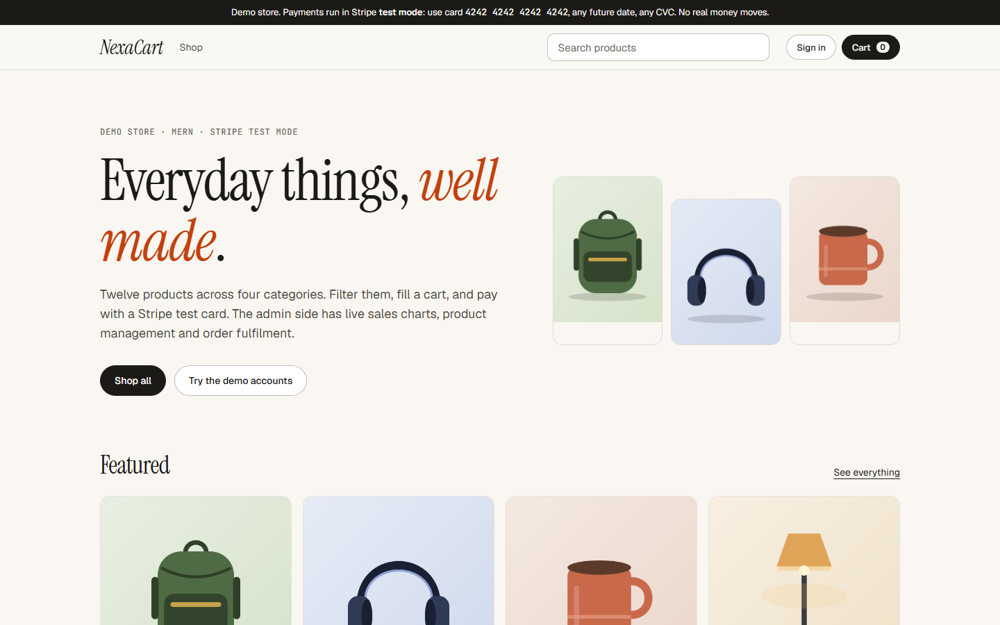
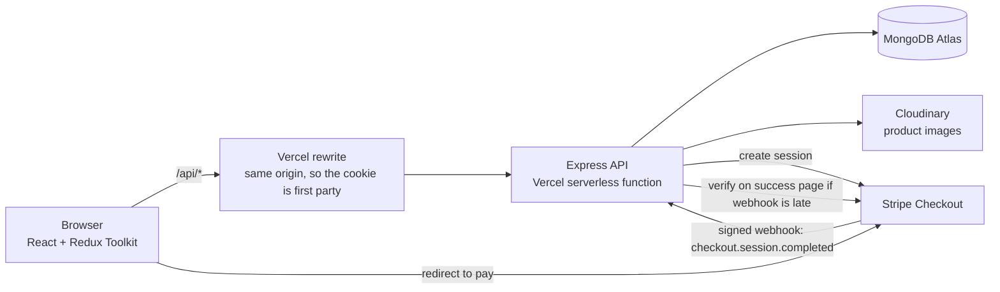

# NexaCart: MERN e-commerce with Stripe test checkout

[](https://github.com/Waleed-Ilyas/nexacart/actions/workflows/ci.yml)


A demo store with a catalogue, filters, cart, Stripe checkout, order history and an admin dashboard with sales charts. **Personal project.** Payments run in Stripe **test mode**, so no real money moves, and the products are fictional.

**Live demo:** CLIENT_URL



## Demo accounts

| Role     | Email             | Password     | What you can do                                                                                     |
| -------- | ----------------- | ------------ | --------------------------------------------------------------------------------------------------- |
| Shopper  | `demo@waleed.dev` | `Demo@1234`  | Browse, check out, see orders                                                                       |
| Admin    | `admin@waleed.dev`| `Admin@1234` | Dashboard, order fulfilment, read the product list. Product changes are switched off on the live demo. |

**Test card:** `4242 4242 4242 4242`, any future expiry, any CVC, any address. The login page has one-click buttons for both accounts.

## Features

- **Catalogue:** 12 products in 4 categories. Search, category, price range and sort, all kept in the URL so a filtered view can be shared or bookmarked. Pagination, loading skeletons, empty and error states.
- **Cart:** Redux Toolkit, persisted in `localStorage`, quantity limits from stock, survives reloads. Only product ids and quantities are sent at checkout, so the total cannot be changed from the browser.
- **Checkout:** Stripe Checkout (hosted page). The server prices the order from the database, checks stock, creates a pending order, and a signed webhook marks it paid. The success page waits for the webhook, then asks Stripe directly if it is late.
- **Auth and roles:** JWT access tokens (15 minutes, kept in memory) plus rotating refresh tokens in an httpOnly cookie, `user` and `admin` roles enforced on the server.
- **Admin dashboard:** revenue over 30 days, top products, orders by status, low-stock alerts. Product create, edit and delete with **Cloudinary image upload**. Order fulfilment (paid, shipped, delivered, or cancelled with restock).
- **Accessible UI:** semantic markup, labelled fields with inline errors, keyboard navigation, visible focus, `aria-live` status messages, charts with text alternatives, reduced-motion support.

## Tech stack

MongoDB Atlas + Mongoose 9, Express 5, React 19 (Vite), Node with TypeScript, Redux Toolkit + RTK Query, React Router, Tailwind CSS v4, Recharts, Stripe, Cloudinary, Zod, Vitest, Supertest, Testing Library, GitHub Actions, Vercel.

## Architecture



The repo has two packages: `server/` (API, models, tests, seed script) and `client/` (the storefront and admin UI).

## Getting started

You need Node 20+, pnpm, and free accounts for MongoDB Atlas, Stripe (test mode) and Cloudinary.

```bash
git clone https://github.com/Waleed-Ilyas/nexacart.git && cd nexacart
pnpm install
cp .env.example .env        # fill in the values, all have free tiers
pnpm seed                   # products, artwork on Cloudinary, demo accounts and demo orders
pnpm dev                    # API on :4000, app on http://localhost:5173
```

For the Stripe webhook locally use the Stripe CLI (`stripe listen --forward-to localhost:4000/api/webhooks/stripe`) and put its signing secret in `.env`. Without it the app still works, because the success page confirms the payment with Stripe directly.

## Tests

```bash
pnpm test          # server: API integration tests, client: reducers, guards, components
pnpm lint && pnpm typecheck
```

- **Server (48 tests):** every endpoint through real HTTP against a real MongoDB (an in-memory one by default, or set `TEST_MONGODB_URI`). Stripe and Cloudinary are replaced with fakes, so nothing touches the network. They cover the auth flow and refresh rotation, forged and expired tokens, role enforcement on every admin route, server-side pricing that ignores client prices, stock limits, webhook signature checks, idempotent payment confirmation, stock never going negative, and admin order transitions.
- **Client (24 tests):** cart logic and persistence (including corrupt storage), exact money conversion, route guards, product card behaviour.
- **End to end:** a Playwright run (not part of CI) that goes through the real site: filters, cart, a real Stripe test payment on the hosted page, order history, admin charts, product create and edit with a real Cloudinary upload, deleting it, and shipping an order.

## Key engineering decisions

- **Money is integer cents everywhere.** Prices, totals and Stripe amounts are integers, and the only place cents become dollars is display formatting. Price inputs are parsed with string arithmetic, so `1.15` is exactly 115.
- **The server owns prices.** The browser sends product ids and quantities. Names, prices and stock come from the database at checkout, and an order stores its own copy of them so later product edits never rewrite history.
- **Webhook and success page both confirm payment, exactly once.** Both call one function that moves an order from pending to paid atomically, so whichever arrives second changes nothing and stock is decremented once. The order records which path confirmed it.
- **Stock cannot go negative.** Decrements clamp at zero, so two shoppers paying for the last unit at the same moment cannot produce a negative count.
- **Refresh tokens rotate and are stored hashed.** A stolen cookie works at most once, and a database leak does not leak usable sessions. Access tokens live in memory only.
- **API and app share an origin.** Vercel rewrites `/api` to the API deployment, so the refresh cookie is first party and works in browsers that block third party cookies.
- **Serverless friendly.** The database connection is cached across invocations, and the Express app is built once per warm instance.
- **The public demo admin is read-only for products.** The admin login is published above, so `DEMO_ADMIN_READONLY` blocks product writes for that one account while a real admin is unaffected.

## Known limitations

- **Shared database.** The live demo and local development can point at the same Atlas database, and the demo orders are generated (flagged `seeded`), not real activity.
- **Rate limiting is per instance.** `express-rate-limit` uses memory, so on serverless the limits are per warm instance, not global.
- **No refresh token reuse detection.** Tokens rotate, but presenting an already used one does not revoke the whole session family.
- **Role changes need a new sign in,** because the role is inside the 15 minute access token.
- **No refunds or emails.** Cancelling a paid order restocks it, but refunds are done in the Stripe dashboard, and no email is sent.
- **Product images are illustrations** drawn in code and uploaded to Cloudinary, not photography.

## What I'd improve next

- Refresh token families with reuse detection, and a shared rate limiter (Upstash Redis).
- Stripe refunds from the admin order screen, and transactional email through Resend.
- Product variants, reviews, and full-text search with a text index and relevance ranking.
- A Playwright suite in CI against a preview deployment, with Stripe test clocks.
- Order status changes pushed to the customer live, and inventory reservations while a checkout session is open.

## Author

Waleed Ilyas, Full Stack Engineer (MERN, Next.js, Solana).
[GitHub](https://github.com/Waleed-Ilyas) · [LinkedIn](https://www.linkedin.com/in/waleed-ilyas-664839213) · waleedilyas99@gmail.com

Released under the [MIT License](LICENSE).
